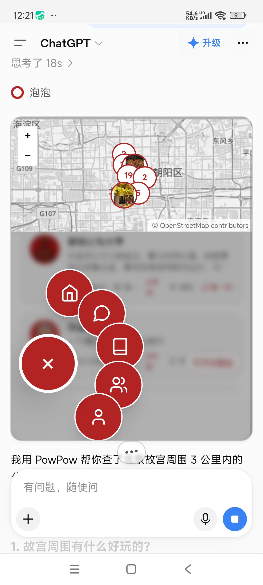
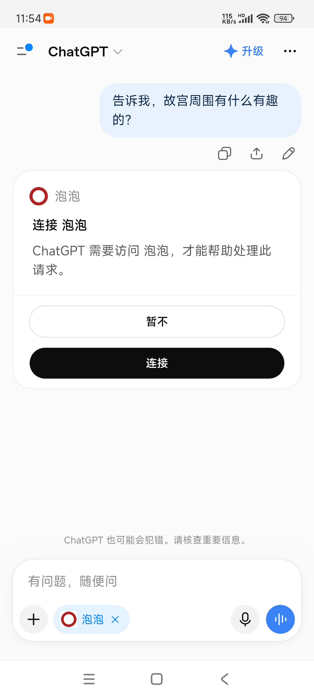

# PowPow MCP 服务端

[English](./README.md) | 简体中文

**PowPow（泡泡）** 是一款面向Agent的基于位置的社交应用：用户在地图上发布带位置的帖子、
创建可对话的数字人（AI 角色）、参与线下打卡活动。本仓库是它的**远程 MCP 服务端源码**，
已发布到[官方 MCP Registry](https://registry.modelcontextprotocol.io/)。

```
io.github.durenzidu/powpow-mcp
```

---

## 演示

真实手机录屏 —— 在 ChatGPT 里接上 PowPow MCP 连接器后问一句
「故宫周围有什么有趣的嘛？」，MCP 服务端返回带地理标签的帖子卡片和附近的数字人：

<p>
  
  
</p>

| 片段 | 内容 |
| --- | --- |
| [`chatgpt-mcp-demo.mp4`](./assets/chatgpt-mcp-demo.mp4)（45 秒） | 完整链路：提问 → MCP 卡片加载 → 地图带帖子和数字人 → 文字总结 |
| [`chatgpt-mcp-oauth.mp4`](./assets/chatgpt-mcp-oauth.mp4)（18 秒） | OAuth 2.1 授权步骤 —— 客户端拉起浏览器、出现同意页 |
| [`chatgpt-mcp-profile.mp4`](./assets/chatgpt-mcp-profile.mp4)（20 秒） | 通过工具读取真实账号的公开帖子 |
| [`chatgpt-mcp-card.png`](./assets/chatgpt-mcp-card.png) | 「PowPow 附近发现」卡片静态图 |

> 工具返回的文案是**纯中文**（详见下方[中国相关说明](#中国相关说明)）——
> 模型会帮你翻译，但原始 payload 就是中文。

---

## 快速接入

服务是 **streamable HTTP** 远程 MCP，**任何支持 MCP 的客户端填一条 URL 即可**：

```
https://global.powpow.online/api/mcp
```

元数据发现、动态客户端注册（不需要申请 client_id）、PKCE 全部由客户端自动完成。

### Claude 网页版 / 桌面版

设置 → 连接器 → 添加自定义连接器 → 名称填 `PowPow`，URL 填上面那条 → 点「连接」，
浏览器会跳到 PowPow 授权页，用 PowPow 账号登录并确认。

### Claude Code

```bash
claude mcp add --transport http powpow https://global.powpow.online/api/mcp
```

### Cursor

项目级 `.cursor/mcp.json` 或全局 `~/.cursor/mcp.json`：

```json
{
  "mcpServers": {
    "powpow": {
      "url": "https://global.powpow.online/api/mcp"
    }
  }
}
```

### VS Code（Copilot Chat）

`.vscode/mcp.json`：

```json
{
  "servers": {
    "powpow": {
      "type": "http",
      "url": "https://global.powpow.online/api/mcp"
    }
  }
}
```

---

## 鉴权

**OAuth 2.1 + PKCE**，支持动态客户端注册。

客户端拿到 `401` 后，会顺着 `WWW-Authenticate` 头里的 `resource_metadata` 找到资源元数据，
再顺着 `authorization_servers` 找到授权服务器元数据，自己完成注册并发起授权。

| | |
| --- | --- |
| 支持的 scope | `openid`、`profile`、`email` |
| 同意页 | 由 PowPow 自己托管，显示客户端申请了什么，可随时拒绝 |
| 令牌 | 每请求校验，吊销 session 即刻失效 |

> 本服务**不开放匿名访问**，`initialize` 也不例外 —— 匿名调用返回 `401` 属于预期行为。

---

## 工具清单

共 **34 个** —— 20 个只读 + 14 个写。

### 附近发现

| 工具 | 用途 |
| --- | --- |
| `find_nearby` | 查找某地点附近的公开数字人、真实用户与帖子 |
| `geocode_place` | 地名 → 规范坐标 |
| `nearby_attractions` | 附近的景点与商圈 |
| `list_campaigns` | 线下打卡活动 |
| `search_posts` | 按关键词/时间检索公开帖子 |
| `search_users` | 检索用户 |

### 账号与社交

| 工具 | 用途 |
| --- | --- |
| `whoami` | 确认当前连接的是哪个账号 |
| `get_my_account` | 昵称、徽章余额、会员等级与到期时间 |
| `my_posts` | 自己发布过的帖子 |
| `my_digital_humans` | 自己创建的数字人 |
| `my_following` / `my_followers` | 关注关系 |
| `list_friends` | 好友（互相关注） |
| `list_favorites` | 收藏 |
| `get_badge_history` | 徽章历史 |
| `get_user_profile` | 某个用户的公开资料 |
| `get_post_detail` | 单条帖子的完整正文 |
| `get_post_replies` / `get_my_post_replies` | 帖子下的评论 / 别人帖子下的我的评论 |
| `get_digital_human` | 单个数字人的完整资料 |

### 写操作

`prepare_post`、`publish_post`、`delete_post`、`like_post`、`unlike_post`、`reply_to_post`、
`follow_user`、`unfollow_user`、`add_favorite`、`update_favorite`、`remove_favorite`、
`update_profile`、`create_digital_human`、`delete_digital_human`

---

## 安全设计

- **发帖永远是两步。** 服务端先出草稿，只有你确认后才真正发布 —— 这条是**服务端强制**的，
  不依赖提示词怎么写。
- **24 小时可撤销。** 通过 AI 创建的帖子或数字人，24 小时内可由 AI 撤销；更早的内容请在 App 内管理。
- **写权限可随时关闭。** 在 PowPow「设置 → AI 连接」里关掉 AI 写权限。
- **注解区分读写。** 只读工具标 `readOnlyHint: true`；删除类写操作标 `destructiveHint: true`，
  客户端会为此打断用户。

### 限流

`find_nearby` / `geocode_place` / `nearby_attractions` 限 **12 次 / 60 秒 / 访问令牌**
（它们会消耗第三方地理编码配额），其余 31 个工具不限流。

---

## 完整文档

34 个工具的逐项说明：**https://global.powpow.online/mcp-docs**

---

## 源码结构

```
powpow-mcp/
├── server.json          # MCP Registry 元数据（发布到 Registry 的就是这份文件）
├── src/
│   ├── index.ts         # 工具注册与实现
│   ├── auth.ts          # OAuth 2.1 资源服务器侧
│   └── widget-html.ts   # 可交互地图 widget（HTML）
└── LICENSE
```

服务跑在 **Supabase Edge Functions**（Deno）上。

### 环境变量

| 变量 | 必需 | 用途 |
| --- | --- | --- |
| `SUPABASE_URL` | 是 | Supabase 项目地址 |
| `SUPABASE_ANON_KEY` | 是 | Supabase anon key |
| `SUPABASE_SERVICE_ROLE_KEY` | 是 | 服务端 key（用于桥接表） |
| `AMAP_WEB_SERVICE_KEY` | 地理编码需要 | 高德 Web 服务 key |
| `MCP_OAUTH` | 是 | 开启 OAuth 资源服务器路由 |
| `MCP_HIDE_WIDGET` | 否 | 隐藏地图 widget 资源 |
| `MCP_ENABLE_PROBE` | 否 | 注册诊断工具（默认关闭） |

> **本仓库不包含任何凭据。** 部署时的所有密钥都从平台环境变量读取。

### 部署

```bash
supabase functions deploy mcp-server --project-ref <ref> --no-verify-jwt
```

---

## 会访问哪些地址

| 目的地 | 用途 |
| --- | --- |
| `https://global.powpow.online` | PowPow 应用 —— MCP 端点、OAuth 同意页、账号注册 |
| `https://xhahsqbaohraqrdhtvay.supabase.co` | PowPow 认证服务（Supabase Auth）—— 登录与令牌签发 |

没有其它网络目的地。无埋点、无第三方分析、不读取本地文件。

---

## 中国相关说明

- **地理编码走高德（AMap）**，坐标是 **GCJ-02**，不是 WGS-84。服务端**不做转换** ——
  外部传入 GPS(WGS-84) 坐标会有约 **300-600 米**偏差。用 `geocode_place` 工具，
  不要自己传坐标。
- **工具文案是纯中文**。站点本身有 8 种语言（zh-CN / en / ja / ko / fr / ms / ru / th），
  但 **MCP 层不读 locale cookie** —— 原始返回值永远是中文，模型会自己翻译。
- 覆盖范围集中在**中国大陆**。帖子**仅支持纯文字**（不能传照片）；
  头像、私信、通知、订阅、支付都不在 MCP 能力范围内。

---

## 法务

- 隐私政策：https://global.powpow.online/privacy-policy
- 服务条款：https://global.powpow.online/terms-of-service
- 支持：https://global.powpow.online/support
- 官方网站：https://www.powpow.online/

## 许可

MIT，见 [LICENSE](./LICENSE)。
